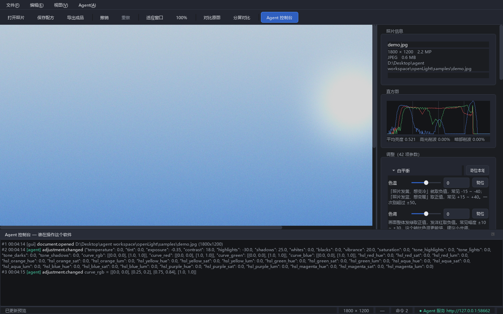

# openLight

面向人和 agent 的 Windows 静态照片处理软件（Lightroom 的轻量替代品）。

和传统修图软件最大的区别只有一句话：

> **人和 agent 用的是同一条命令总线。**

界面上的每一次拖动、agent 发来的每一条指令，都会变成同一种 `command`，
由同一个内核执行。所以不存在「界面上能点、接口里没有」的功能，
也不存在「agent 改了但人不知道」的黑箱。



## 当前版本 v0.2.1（Demo）

**42 个调整项**，分 6 组，全部非破坏性：

| 组 | 参数 |
| --- | --- |
| 白平衡 | 色温、色调 |
| 基本 | 曝光、对比度、高光、阴影、白色色阶、黑色色阶 |
| 偏好 | 自然饱和度、饱和度 |
| 色调曲线 | 高光区、亮调区、暗调区、阴影区（升余弦权重叠加成平滑曲线） |
| 曲线 | RGB 综合 + 红/绿/蓝 三条通道曲线（可拖点的单调三次样条） |
| HSL 混色器 | 8 个色带 × 色相 / 饱和度 / 明亮度 |

- 非破坏性编辑：原图永不修改；参数可回滚、可存成 sidecar 配方。
- 深色专业界面：画布缩放/平移、拖入打开、直方图、按住对比原图、分屏对比、
  可折叠的参数分组（标题上直接显示「已调 N 项」）、带直方图背景的曲线编辑器。
- 每次渲染都返回画面统计（平均亮度、高光/暗部削波比例、实际生效的处理级），
  agent 靠它「调整 → 看图 → 再调整」地收敛，而不是瞎猜参数。
- 全部默认时逐像素等于原图（`identity: true`），不做无用功。
- 三个入口跑同一个内核：

| 入口 | 谁用 | 形态 |
| --- | --- | --- |
| 图形界面 | 人 | PySide6 窗口 |
| HTTP + JSON API | 任何程序 | `127.0.0.1:8765` 本地服务 |
| MCP Server | 多模态 agent | stdio，挂进 Codex / Claude 等 |

外加一个命令行客户端（`python -m openlight.cli`），方便 agent 用 shell 驱动。

## 跑起来

首次使用，双击 **`setup.cmd`**（创建独立运行环境、装依赖，约 1 分钟）。

之后双击 **`start.cmd`** 就能打开软件。

喜欢命令行的话：

```powershell
.\.venv\Scripts\python.exe run_gui.py            # 带界面
.\.venv\Scripts\python.exe run_gui.py D:\a.jpg   # 带界面并直接打开照片
.\.venv\Scripts\python.exe run_api.py            # 无界面，只开 agent 接口
```

## 让 agent 来操作

软件一启动，agent 接口就自动开了。人和 agent 可以同时对同一张照片工作。

```powershell
# agent 先问：你会什么？
.\.venv\Scripts\python.exe -m openlight.cli schema

# 打开照片、调曝光、看预览、导出
.\.venv\Scripts\python.exe -m openlight.cli open "D:\photo\a.jpg"
.\.venv\Scripts\python.exe -m openlight.cli exposure +0.8
.\.venv\Scripts\python.exe -m openlight.cli preview --out look.png
.\.venv\Scripts\python.exe -m openlight.cli export "D:\photo\a_edited.jpg"

# 任意调整项：名字和范围用 schema 查
.\.venv\Scripts\python.exe -m openlight.cli set contrast 25
.\.venv\Scripts\python.exe -m openlight.cli set hsl_blue_lum -30

# 曲线：传控制点 JSON
.\.venv\Scripts\python.exe -m openlight.cli curve curve_rgb "[[0,0],[0.5,0.62],[1,1]]"
```

或者直接走 HTTP：

```powershell
curl -s http://127.0.0.1:8765/schema
curl -s http://127.0.0.1:8765/command -H "Content-Type: application/json" -d "{\"cmd\":\"adjustment.set\",\"params\":{\"id\":\"exposure\",\"value\":0.8}}"
curl -s -o look.png http://127.0.0.1:8765/preview      # 直接拿一张图看

# 一次设置一整组参数（只占一步历史，可一次撤销）
curl -s http://127.0.0.1:8765/command -H "Content-Type: application/json" -d "{\"cmd\":\"adjustments.set_batch\",\"params\":{\"adjustments\":{\"contrast\":25,\"temperature\":-15,\"curve_rgb\":[[0,0],[0.5,0.62],[1,1]]}}}"
```

接到支持 MCP 的 agent 上（在软件里点「Agent 接口 → 复制 MCP 配置」可直接复制这段）：

```json
{
  "mcpServers": {
    "openlight": {
      "command": "python",
      "args": ["-m", "openlight.mcp"],
      "cwd": "C:\\Users\\user\\Desktop\\agent workspace\\openLight"
    }
  }
}
```

挂上之后 agent 就多了这些工具（20 个，覆盖全部命令）：

| 工具 | 作用 |
| --- | --- |
| `openlight_schema` | 自述文档：42 个参数的名字、范围、语义、用法建议 |
| `openlight_status` | 当前照片、当前生效的调整、可撤销步数 |
| `openlight_open_image` / `openlight_close_image` | 打开 / 关闭照片 |
| `openlight_adjust` | 一次设置多个参数（少往返，一步历史） |
| `openlight_set_adjustment` | 设置任意一个参数（标量或曲线） |
| `openlight_set_curve` | 设置 RGB / 红 / 绿 / 蓝 曲线 |
| `openlight_set_exposure` | 调曝光（带画面统计和建议） |
| `openlight_measure` | 只量不拍：平均亮度、削波比例、实际生效的处理级 |
| `openlight_see_image` | 把当前画面作为图片喂给多模态模型 |
| `openlight_save_preview` | 把预览存成 PNG 文件（不占上下文） |
| `openlight_reset` / `openlight_reset_all` | 复位一项 / 复位全部 |
| `openlight_undo` / `openlight_redo` / `openlight_history` | 撤销 / 重做 / 查看历史栈 |
| `openlight_export` | 导出全分辨率成品 |
| `openlight_save_recipe` / `openlight_load_recipe` | 存 / 载 sidecar 配方 |
| `openlight_runs` | 回看操作记录（含人的手动操作） |

它可以「调一次 → 看一次图 → 再调」，像人一样反复确认。

### 一个「一句话自动修图」的例子

`tools/auto_exposure.py` 演示了 agent 该有的工作方式：不是猜参数，而是
**测量 → 调整 → 再测量**，用软件返回的画面统计收敛到目标亮度：

```powershell
.\.venv\Scripts\python.exe tools\auto_exposure.py "D:\photo\a.jpg" --target 0.55
```

```
  步     曝光 EV       平均亮度      高光削波% 动作
  1     -0.14      0.582       0.88 压暗
  2     -0.14      0.556       0.00 收敛，停止
已导出：D:\photo\a_openlight.jpg（曝光 -0.14 EV）
```

把同样的循环交给多模态 agent，它还能做那些只能靠「看」来判断的事
（构图、主体、氛围）。软件负责给出可执行的原子操作和客观反馈。

## 目录结构

```
openlight/
  core/            内核：调整项注册表、渲染引擎、文档、历史、命令总线
    adjustments.py   调整项在这里「描述一次」，界面和 agent 同时获得
    engine.py        像素运算（场景线性空间，按行分块）
    color.py         sRGB 线性化、HSL 互转、HSL 混色器的色带定义
    curves.py        曲线数学（单调三次样条 / 分区色调曲线 / 色带插值）
    session.py       唯一的写入通道 Session.execute(command)
  api/             对外接口
    catalog.py       命令目录（agent 的自述文档来源）
    server.py        HTTP + JSON API
    mcp_server.py    MCP server（含图片 content block）
    gateway.py       线程编排：HTTP 线程 -> 界面线程
  ui/              图形界面（只是命令总线的一个客户端）
  cli.py           命令行 / agent 入口
docs/              面向 agent 的接口文档
tools/             自检、测试、演示脚本
run_gui.py         启动界面
run_api.py         无界面模式
setup.cmd          首次安装
start.cmd          日常启动
```

## 测试

```powershell
.\.venv\Scripts\python.exe tools\selfcheck.py     # 内核：42 个参数逐个验证 + 撤销/导出/sidecar
.\.venv\Scripts\python.exe tools\apitest.py       # HTTP API + MCP + CLI
.\.venv\Scripts\python.exe tools\uitest.py        # 界面（离屏，不弹窗）
```

三个脚本都只输出可读的检查项，适合每次改完代码跑一遍。

## 接下来可以往哪儿走

1. **加调整项**：注册表里加一行 + 引擎里加一个算子即可，
   界面滑块、`adjustment.set`、`app.schema`、MCP 工具都会自动跟上。
   候选顺序：清晰度/去朦胧 → 局部调整（画笔、渐变滤镜）→ 白平衡吸管 → 裁剪。
2. **批处理**：给命令总线加 `batch.apply`，agent 就能一次处理一整个文件夹。
3. **打包成 exe**：PyInstaller 一行命令，做成不需要 Python 的独立程序。
4. **接更强的 agent**：把 MCP 挂到真正的多模态模型上，
   让它自己决定「这张照片该提亮多少」，软件只负责执行和反馈。

## 版本记录

### v0.2.1
- **MCP 工具补齐到 20 个**，与命令总线一一对应：新增关闭照片、复位全部、查看历史栈、
  `openlight_measure`（只量不拍，省上下文）、存预览、存/载配方。
- **界面在缺字体的环境里也不再出豆腐块**：新增 `openlight/ui/fonts.py`，
  先找系统字体、再注册字体文件，都失败就直接报错，不会静默输出方框。
  截图脚本保存前会审计所有控件文案，缺字形就不落盘。
- 修侧栏分组标题空白、数字框上下箭头在深色底上一条灰杠、截图脚本退出时渲染线程未关闭。
- 文档截图换名 `docs/screenshot-ui.png`（旧路径被缓存过）。

### v0.2.0
- 首个公开版本：42 个调整项、单一命令总线、HTTP JSON API、MCP server、PySide6 界面。

## 设计原则（改动代码时请守住）

1. **单一命令总线**：GUI 不直接改数据，只发命令；agent 发同样的命令。
2. **可发现性**：能力只描述一次（adjustments 注册表 + catalog），自动暴露给所有入口。
3. **确定性**：渲染是 `(源图, 参数) -> 图像` 的纯函数，可重放、可对比。
4. **可观测**：所有变更写入事件日志（带序号、带来源），人和 agent 互相看得见。
5. **可回滚**：人和 agent 共用同一个历史栈。
6. **结构化错误**：`error.code` 用于程序判断，`error.hint` 用于自我纠正。

接口细节见 [docs/AGENT_GUIDE.md](docs/AGENT_GUIDE.md)。

---

作者：**6zizel** · 仓库：<https://github.com/Jize678/OL>
